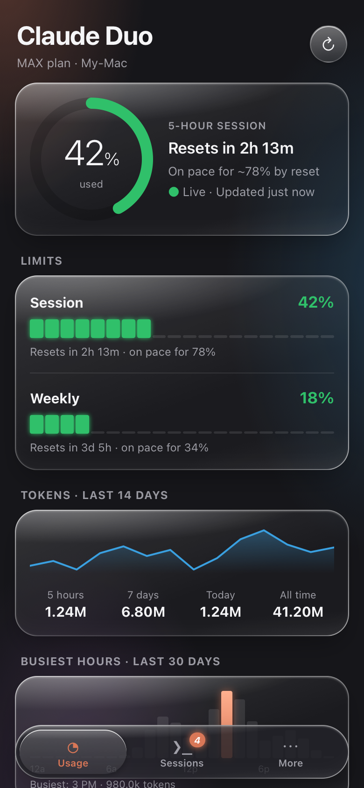
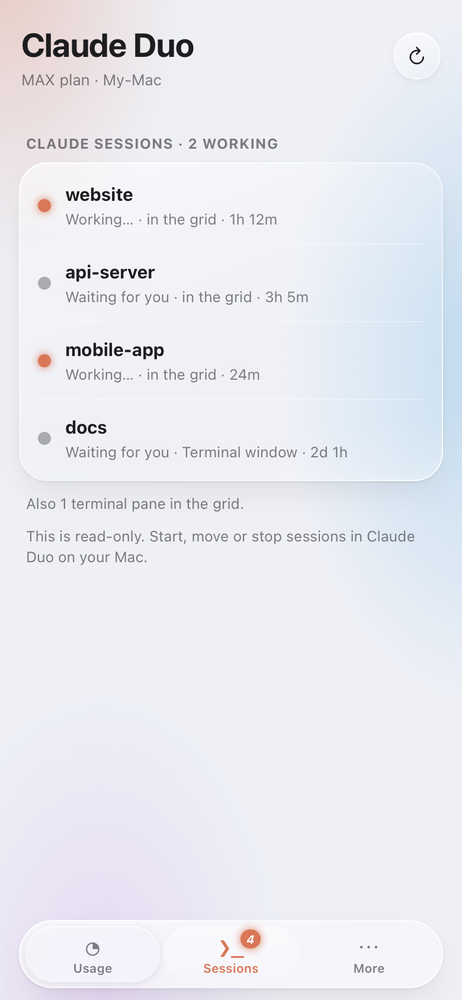

# Claude Duo

A menu bar app for people who live in [Claude Code](https://claude.com/claude-code), for macOS and Windows, with an iPhone version.

## New: Claude Duo on your iPhone

Check your Claude limits from the couch. Claude Duo on your computer (Mac or Windows) serves a phone version over your Wi-Fi:
scan a QR code, tap **Add to Home Screen**, and it opens full screen like any other app. No App Store, no
Xcode, nothing to install on the phone.

<p align="center">
  
  &nbsp;&nbsp;
  
</p>

- **Usage**: your 5-hour and weekly limits with reset countdowns and pace, live from your Mac, plus token
  charts, busiest hours, top projects and models.
- **Sessions**: every Claude session on your Mac, and whether it's working or waiting for you.
- **Light or dark**: More → Appearance, saved on the phone.
- **Safe**: look-only, behind a secret link, and only on your own network.

[Set it up in a minute →](#iphone-app) *(Screenshots use demo data.)*

## Download

Two files on the [Releases page](https://github.com/bb520xx-code/Claude-Duo/releases): pick the one for your computer.

- **Mac** (Apple silicon): `Claude-Duo-Mac.zip`. Open it, drag **Claude Duo** to Applications, open it.
  The first time, macOS says it can't check the app: open **System Settings → Privacy & Security** and click
  **Open Anyway**. Nothing else to install (the pane grid needs tmux: `brew install tmux`).
- **Windows**: `Claude-Duo-Windows.exe`. Run it (details below).

## On Windows (beta)

**Download `Claude-Duo-Windows.exe` from the [Releases page](https://github.com/bb520xx-code/Claude-Duo/releases)** and run it. Nothing else to install.

- Your plan % sits in the **system tray** by the clock, in green, yellow or red. Hover for the reset times,
  click for the popup. If you don't see it, drag it out of the **^** overflow.
- The same popup, dashboard, Settings, live numbers, notifications and iPhone app as on the Mac.
- **Sessions** lists your Claude Code sessions and opens new ones in **Windows Terminal**. The pane grid is
  Mac-only (it needs tmux).
- The first time, Windows may warn about an unknown publisher: choose **More info → Run anyway**. Turning on
  the iPhone app makes Windows ask whether to allow it on your network: allow **private networks**.
- From the code instead: install Python 3.12, then in this folder run
  `powershell -ExecutionPolicy Bypass -File .\install.ps1` (adds Claude Duo to the Start menu).

Every change is built and tested on Windows and on a Mac by GitHub (`.github/workflows/build.yml`), including
opening the real Windows windows and tray icon. A version tag such as `v2.1.0` publishes both downloads on the
Releases page.

## On your Mac

- **Plan usage in the menu bar**: `✦ 47%` for your 5-hour session (or weekly, or both), coloured
  green → yellow → red at thresholds you choose. A `●` appears while any Claude session is working.
- **Live, exact numbers**: with *Live numbers from Claude Code* on (⚙), the % comes from the usage figures
  Anthropic sends back with every Claude reply, so it updates within a second and can't be rate-limited.
  Otherwise it checks Anthropic's usage endpoint, and always shows how fresh the number is.
- **Liquid Glass popup** with Usage, Sessions and Settings tabs: limits with reset times and pace,
  busiest hours, a 14-day token sparkline.
- **One terminal grid for all your sessions**: Claude Code and plain shell panes in a single tmux window
  you can drag and resize with the mouse. Move an existing Claude Code session into the grid with its
  full conversation (`claude --resume`).
- **Crash-proof grid**: the layout, each pane's folder, its Claude conversation, screen text and shell
  history are saved every few seconds and rebuilt after a crash or restart.
- **Projects on an external drive**: eject or unplug the drive and its sessions pause in their panes (the
  eject isn't blocked by them); plug it back in and each one picks up where it left off by itself, even
  after a restart. Keep the app itself on the Mac (`~/Applications`), so it's there when the drive isn't.
- **One drive, two Macs**: pair a folder on the drive with one on each Mac (`"drive_sync": [{"drive":
  "/Volumes/My Drive/Projects", "local": "~/Projects"}]` in `config.json`; one Mac is enough, the pair is
  written on the drive). While it's plugged in, changes are copied both ways every minute and on eject (the
  newer file wins, the replaced one is kept; deleting doesn't delete on the other side). Your settings, the
  grid and its Claude conversations go on the drive too: plug it into your other Mac and it opens the same
  grid, each pane carrying on its conversation in that Mac's copy of the folder.
- **iPhone app**: your usage, limits, token charts and which sessions are working, on your iPhone's Home Screen.
- **Notifications** near your limit and when Claude finishes in any session.
- **Light or dark**: ⚙ → Appearance switches every window to Light or Dark, or Auto to follow your Mac.
- Quick links to claude.ai settings, billing, docs and status.

> Not affiliated with Anthropic. Uses the sign-in Claude Code already saved on your Mac to read your
> plan usage, and talks only to `api.anthropic.com`. Everything else stays on your machine.

## Requirements

- Claude Code, signed in with a Claude plan (Pro / Max)
- Mac: Apple silicon. Windows: Windows 10 or 11.
- Only to install from the code on a Mac: [Homebrew](https://brew.sh), Python 3.14 and tmux (the installer adds
  the last two via Homebrew)

## Install

Easiest: the Mac download above. Or from the code:

```sh
git clone https://github.com/bb520xx-code/Claude-Duo.git
cd Claude-Duo
./install.sh
open ~/Applications/"Claude Duo.app"
```

The installer copies the code to `~/ClaudeUsage`, creates a Python virtual environment there, and builds
`~/Applications/Claude Duo.app` (a small C launcher that runs the Python app in-process, so macOS gives it a
menu bar icon). If the icon doesn't show, allow Claude Duo under System Settings → Menu Bar.

## Use

- Click `✦ %` in the menu bar for the popup. Keys: `1` Usage, `2` Sessions, `,` Settings, `R` refresh.
- **Sessions → Add a pane** opens Claude Code or a terminal in a folder; **⇲** moves another Terminal
  window's Claude session into the grid.
- ✕ hides the window and the app keeps running; ⌘Q or ⏻ quits.
- **⚙ → Live numbers from Claude Code** adds a small status line to Claude Code (`~/.claude/settings.json`)
  that passes on the usage numbers from each reply; it keeps any status line you already had, and turning
  it off puts yours back.

Organization API usage (Console) needs an Admin API key (`sk-ant-admin…`), pasted in the Usage tab.
It is kept in memory only.

## iPhone app

Claude Duo on your Mac also serves a phone version over your Wi-Fi.

1. On the Mac: Claude Duo **⚙ → iPhone app** (on). A QR code appears.
2. On the iPhone: point the Camera at the QR code and tap the link.
3. In Safari tap **Share → Add to Home Screen**. It opens full screen with the Claude Duo icon, like an app.

It shows the same numbers as the Mac: the session and weekly limits with reset times and pace, token charts,
busiest hours, top projects, models, and which Claude sessions are working or waiting for you.

- **Read-only.** It has no way to change anything on the Mac: no terminal or settings endpoints exist on its
  port (8766), and it only answers under a secret link. **⚙ → New link** locks out every phone that had the old one.
- **Same Wi-Fi.** The iPhone needs to be on the Mac's network (or a VPN such as Tailscale to reach it from
  anywhere). Away from it, the app shows the last numbers it got, and a link to the official usage page on claude.ai.
- **Why not the App Store or a download?** iPhones only install apps from the App Store, TestFlight or Xcode.
  A Home Screen web app needs none of that, and its code ships here in `iphone/` and `phone.py`.

## Develop

Build the Mac download yourself with `./build-mac.sh python3` (needs `pip install -r requirements.txt segno pyinstaller`).

```sh
cd ~/ClaudeUsage
PYTHONPATH=.:.venv/lib/python3.14/site-packages /opt/homebrew/bin/python3.14 -m unittest discover -s tests
```
